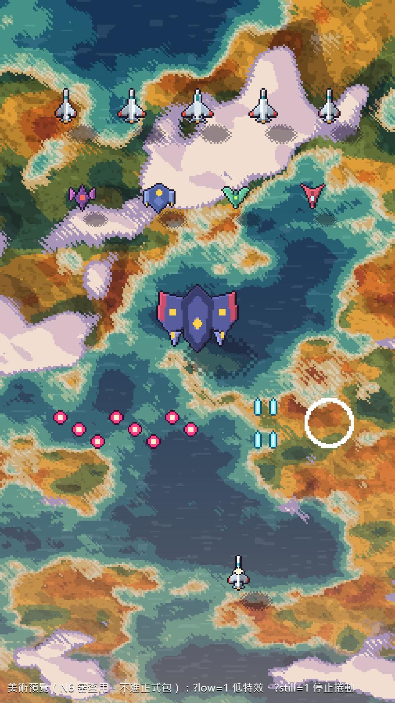
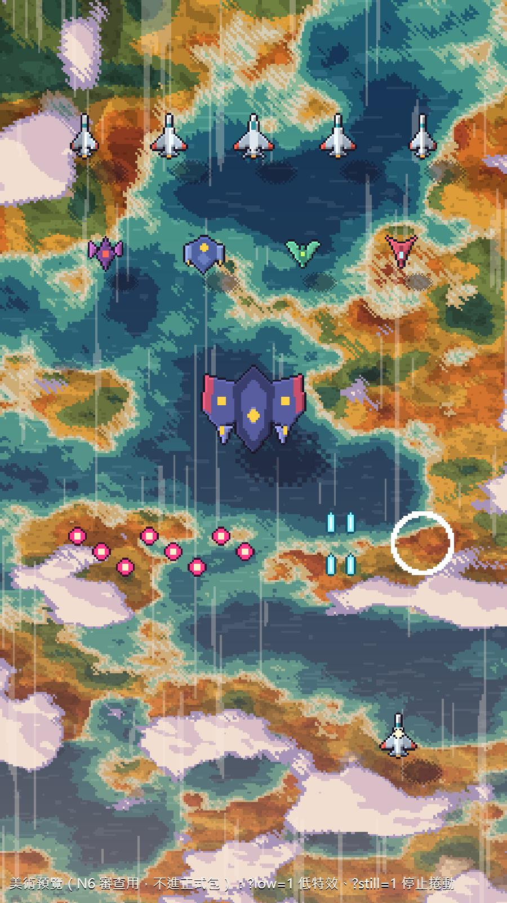
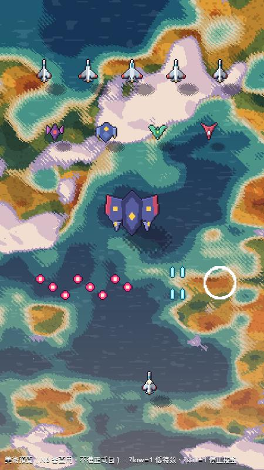
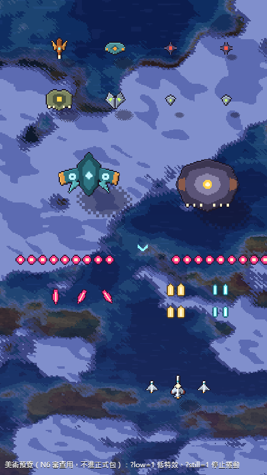
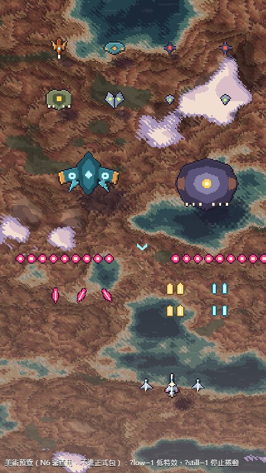
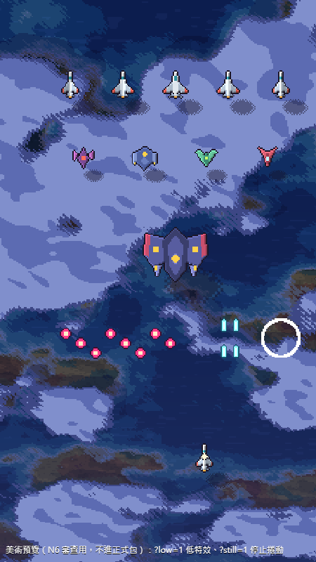
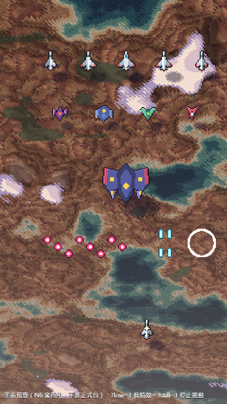

# SkyTalon 美術

> 方法：[06_art-pipeline](../../knowledge-base/06_art-pipeline.md)（§5 授權）、[10_asset-library](../../knowledge-base/10_asset-library.md)（登錄與重用）、[07_themes-and-liveops](../../knowledge-base/07_themes-and-liveops.md)（選皮與在地化）、[11_terrain-style-kit](../../knowledge-base/11_terrain-style-kit.md)（地表驗收觀念）。資產清單：[manifest.json](manifest.json)。

本作沒有圖檔：地表是一支 shader（v4 起有三種章節樣貌），機體、敵機、子彈、特效是開機時用程式畫出的一張 atlas（寬 128）。沒有用任何外部素材或生圖工具。

## 預覽

| 一般 | 全速（`?rush=1`） | 低特效 |
|---|---|---|
|  |  |  |

實機預覽頁（開發用，不進正式包）：`npm run dev` 後開 `/art-preview.html`；`?low=1` 低特效、`?still=1` 停止捲動、`?rush=0..1` 預覽速度感。

### v4（第三期）新增

| 第二章敵機與頭目（雲海夜航） | 第三章敵機與頭目（峽谷黎明） | 雲海夜航（第一章的機體） | 峽谷黎明 |
|---|---|---|---|
|  |  |  |  |

兩張 v4 圖的內容相同，只換地表：第一列狙擊機、佈雷機、兩顆水雷；第二列彈牆艦、分裂機、兩架碎片機；中間左是頭目二風暴號、右是頭目三要塞核心；下面是一排彈牆（中間的缺口與青色缺口標記）、三個角度的狙擊快彈、重彈（金）與一般子彈（青）；最下面是機體與兩架僚機。

預覽頁參數：`?sheet=2` 看 v4 的圖、`?ch=0|1|2` 換章節地表。

## 方向

- **視角**：俯視，機頭朝上，地表往下捲。
- **色調**：傍晚。地表是暖色（金、琥珀、鏽）配冷色（松綠、青綠、深海藍），整體壓暗一階，讓子彈與機體是畫面上最亮、對比最高的東西。
- **像素**：1 美術像素 = 3 世界像素（世界 720×1280），地表與 sprite 同一個像素大小，最近鄰放大。
- **可讀性優先序**：敵彈（洋紅加奶油色核心、深色描邊）＞玩家機（冷白）＞敵機（藍紫系機身加各自的亮色核心）＞地表。

## 假 3D 的做法

| 手法 | 位置 | 說明 |
|---|---|---|
| 透視壓縮 | `ground.js` | 畫面上方較遠：同樣一列像素涵蓋更多地面，所以遠處地形較小、捲動較慢 |
| 地形起伏 | `ground.js` | 高度場朝左上方取樣算坡向，分向陽、平、背陽三階明暗 |
| 雲層視差 | `ground.js` | 雲在機體下方，捲動是地表的 1.7 倍；雲影落在雲的右下 |
| 遠處霧 | `ground.js` | 越上方越偏暖色 |
| 速度感 | `ground.js`、畫面層 | 捲動速度隨段落上升、連鎖越高越快；加速時透視加深、機體下方出現細長的霧絲速度線；另有從上往下掠過的風切線與拉長的凝結尾。全部只在畫面層，不影響規則 |
| 倒角與描邊 | `atlas.js` | 每個 sprite 左上亮、右下暗，加深色外框，看起來是有厚度的物體 |
| 側傾 | `atlas.js` | 玩家機 5 格：機翼橫向變窄，一邊受光一邊背光 |
| 落影 | 畫面層 | 每架飛機在右下方有陰影，飛得越高離得越遠 |

## 資產表

| 幀 | 美術像素 | 對應 sim 半徑（世界像素） | 說明 |
|---|---|---|---|
| `jet0`–`jet4` | 22×24 | 被彈判定 9（比機身小很多，中心另畫亮點 `core`） | 玩家機，5 格側傾 |
| `drone` | 17×17 | 22 | 直落機，紫色、紅核心 |
| `gunner` | 20×20 | 26 | 砲艇，藍色、黃核心與砲口 |
| `weaver` | 18×16 | 24 | 蛇行機，綠色、萊姆核心 |
| `diver` | 16×18 | 20 | 俯衝機，紅色、淡青核心 |
| `boss` | 50×44 | 70 | 頭目，深藍紫、三個黃核心 |
| `enemyShot` | 9×9 | 7 | 敵彈 |
| `playerShot` | 5×11 | 8 | 玩家子彈 |
| `shadow` `ring` `puff` `spark` `dot` `core` | 小 | — | 陰影、擴散環、凝結尾與爆炸粒子、判定亮點 |

### v4 新增的幀

| 幀 | 美術像素 | 對應 sim 半徑 | 說明 |
|---|---|---|---|
| `lancer` | 16×19 | 22 | 狙擊機，橘色細長機身、青色核心 |
| `miner` | 22×14 | 24 | 佈雷機，青綠色扁平機身、橘色核心 |
| `mine` | 11×11 | 16 | 水雷，深紫帶刺、紅色核心 |
| `bulwark` | 24×22 | 34 | 彈牆艦，橄欖色厚板、黃核心、四個發射口 |
| `splitter` `shard` | 19×18、10×10 | 26、14 | 分裂機（中間一條接縫）與碎片機，灰藍、萊姆核心 |
| `boss2` | 56×42 | 76 | 風暴號，深青綠、橘色翼緣、兩個環形發射器 |
| `boss3` | 58×50 | 84 | 要塞核心，冷色鋼紫八角形、黃核心、下緣六個發射口 |
| `wing` | 12×13 | — | 僚機，與玩家機同色 |
| `lance` | 7×15 | 7 | 狙擊快彈，洋紅加奶油色核心（與一般敵彈同色系，細長，依飛行方向旋轉） |
| `heavyShot` | 7×12 | 8 | 重彈，金色 |
| `gapMark` | 11×8 | — | 彈牆缺口標記（箭頭，畫面層上色） |

### 三章地表

| 章 | 樣貌 | 做法 |
|---|---|---|
| 一 海岸黃昏 | 原本的島嶼與秋色林地 | `uChapter` = 0 |
| 二 雲海夜航 | 月光下的雲海，地面壓成深藍 | `uChapter` = 1：雲量加多、雲改成藍紫三階、整體乘上月光色、遠處霧改深藍。沒有純黑 |
| 三 峽谷黎明 | 分層的紅岩與零星灌木，水只剩最深的切谷 | `uChapter` = 2：海平面降低、林地換成依高度分層的岩色、雲量減少、降飽和並壓暗 |

章與章之間用小數混合兩種樣貌（N7 在頭目倒下到改裝選完之間轉場）。

### v8（航段一「守住地球」）新增

預覽：[v8_ships_x6.png](preview/v8_ships_x6.png)（主角機四種狀態與八個頭目位）、[v8_atlas_x4.png](preview/v8_atlas_x4.png)（整張圖集放大 4 倍）。重產：`node art/tools/atlas-preview.mjs`。

| 項目 | 做法 |
|---|---|
| 主角機 | 改用兩倍美術解析度（44×48 格，以一半的像素倍率顯示），所以在同樣大小裡多了面板線、進氣口、雙垂尾、機鼻罩、座艙反光、翼尖紅白條紋與雙引擎。五格側傾照舊 |
| 裝備掛件 | 每件裝備是疊在機體上的小圖，跟著側傾一起橫向壓縮。連射是機鼻兩側的砲管，重彈是翼下的金色莢艙，散射是往外斜的鴨翼，推進器是加大的噴口，這四種各有三級、越升越大；穿透是機鼻下的綠尖長槍，電漿砲是機身的紫色線圈與機鼻發射器，護盾是翼尖與機背的綠色發射點 |
| 太空型態 | （已由「主角機的升級型態」的重裝型取代）原做法：第四章起自動換上，照使用者給的範例圖與設計重點堆疊在同一架機體上。保留白色中軸機身、深色機鼻、青色座艙、橘紅白翼尖與中央主噴口；加上座艙兩側到翼根的深藍灰裝甲板（白邊、鉚釘）、主翼中段的大型推進莢艙（白色頂蓋、青色感測燈、各自的噴口火焰）、機翼前緣的雙聯裝砲管、外側的微飛彈掛架（紅色彈頭） |
| 小王一 涅柔斯（海之長者） | 青綠色艦身，艦首三支尖叉，艦尾一對魚尾鰭 |
| 頭目一 俄刻阿諾斯（環繞世界的大洋） | 深海藍艦身。前方一對蟹螯（古代圖像裡他頭上有蟹螯狀的角），艦尾一對角與尾鰭，兩側是帶白色浪頭的波浪鰭，核心外面一圈水環 |
| 小王二 玻瑞阿斯（北風） | 淺藍長後掠翼，翼上有一片片導流板，像風標；翼下掛冰柱 |
| 頭目二 倪克斯（夜） | 靛藍色垂幕般的大翼，上面撒滿星點，翼緣是較亮的裙邊；上方一對深色的翼；艦身上一彎新月 |
| 小王三 安泰俄斯（大地的巨人） | 土褐色重裝艦，肩部是岩板，下方一對粗前臂，帶苔點 |
| 頭目三 厄俄斯（黎明） | 暮紫色的戰車艦身，兩側各五道玫瑰色與番紅花色相間的光芒（「玫瑰色手指的黎明」），核心是一個有輻條的車輪 |
| 小王四 伊里斯（彩虹，眾神的信使） | 紫色細長艦身，機翼上五條彩虹色帶 |
| 頭目四 阿特拉斯（扛著天穹的泰坦） | 青銅色的雙臂與肩膀，托著一顆大天球：深藍球面、經線與赤道、一圈黃道環、滿天星點 |
| 運輸機 | 灰藍貨船，甲板上三個不同顏色的貨櫃 |
| 甲殼 | 六角板的像素幀（青色四階色階，內緣抖色，兩格輪流換亮角），一層一片、每片轉 30 度；被打掉時碎成小片飛散 |

#### 主角機的升級型態（用使用者提供的參考圖）

使用者 2026-11-20 提供三張用 Gemini 生成的機體圖，並表示這個風格比我用多邊形畫的掛件好。這三張直接轉成遊戲用的圖格（預覽：[v8_ship_forms.png](preview/v8_ship_forms.png)；重產：`python art/tools/ship_forms.py`）。

| 型態 | 來源 | 什麼時候出現 |
|---|---|---|
| 原型機 | 程式繪製（44×48） | 裝備總等級 0 到 2；這時裝備仍用疊上去的小掛件表示 |
| 展翼型 | `art/raw/ship_wing.jpg`（92×94） | 裝備總等級 3 以上 |
| 重裝型 | `art/raw/ship_heavy.jpg`（73×91） | 裝備總等級 7 以上；進太空（第四章）後至少是這個型態 |
| 軌道砲型 | `art/raw/ship_rail.jpg`（82×82） | 裝備總等級 12 以上 |

- 換型態的瞬間有一圈衝擊環與碎片。型態只是畫面，判定仍是機身中央的亮點。
- 轉換是機械式的，沒有手修：找出原圖一個美術像素的大小（10.24 px），每格取一個顏色，去背景，三張共用 40 色。遊戲裡不放圖檔，資料寫在 `game/src/render/shipForms.js`（約 24 KB）。
- 這三張的美術像素比圖集其他東西細三倍，所以放在自己的一張貼圖、用平滑取樣顯示（一個美術像素等於一個世界像素）。Draw Call 不變（同一批次）。
- 授權：圖是使用者自己用 Gemini 生成並提供的，提示詞沒有留存。上架前請確認當時的 Gemini 使用條款允許商用，並把提示詞補進 `art/prompts/`（知識庫 06 的授權欄要求）。
- 風格是「機甲套件」這一類，不是任何一架既有作品的機體。三張圖我看過，沒有可辨識的既有機體特徵（沒有 V 形天線、沒有特定機體的配色分割）；這一點也請審查人確認。

#### 像素特效（取代原本「放大一個白色圓環再染色」的做法）

使用者指示：「將光圈護盾等改成 pixel vfx 渲染，不要用目前的土砲方案」。做法照 [knowledge-base/18](../../knowledge-base/18_pixel-vfx-codex.md) 的規則用程式重做，0 bytes，沒有複製該專案的程式或圖。

| 特效 | 幀 | 動態 |
|---|---|---|
| 機體護盾 | 綠色四階色階，8 格：受光的亮緣、緣內一圈抖色、一個沿著邊緣跑的高光、一道掃過盾面的斜向光帶 | 重建好時回彈彈出；脈動是尖起慢落；被打掉時先一格衝擊環，再碎成十來片往外飛、越飛越慢、直接消失不淡出 |
| 無敵護盾 | 同上，青色色階 | 快結束時逐格閃爍，不用半透明 |
| 精英機的金色力場 | 同上，金色色階 | 持續循環 |
| 衝擊環 | 白色 6 格，由畫面染色：半徑先快後慢地變大、線條越來越細，最後兩格用抖色與缺口碎開 | 敵機爆炸、頭目爆炸（三倍）、選裝備的清場、電漿放出 |
| 碎片 | 三種小方塊 | 帶阻力，先快後慢 |

色階規則：每套四階，最暗一階是飽和的中暗色並偏藍，最亮一階收在暖白；不用平滑漸層，柔邊一律是 4×4 Bayer 抖色。所有幀以整數倍像素顯示（護盾彈出的 0.2 秒除外）。護盾的大小是固定的像素幀，和 sim 的判定無關（判定在機身中央的亮點）。

世界觀是「眾神的先鋒艦隊」。使用者的指示是「設計與該神祇常見形象接近的樣貌，並轉化成 boss 戰艦」：每艘艦帶著那位神祇在古典圖像裡的特徵物（蟹螯、星幕、車輪、天球、彩虹、三叉），但畫的是艦艇，不畫神像、人臉、人形、光環、廟宇。特徵取自神話裡的通用描述，沒有照任何一張現成的圖畫。名字只出現在頭目進場的橫幅文字。

### v9（頭目三階段）新增

預覽：[v9_boss_forms.png](preview/v9_boss_forms.png)（四個頭目各三個階段，下面是四個小王；洋紅點是核心位置）。重產：`python art/tools/boss_forms.py`。

| 項目 | 做法 |
|---|---|
| 來源 | 圖由 Codex 依 [boss_brief.md](boss_brief.md) 生成，原圖在 `art/raw/boss/`，提示詞全文在同一個資料夾的 `prompt_big.sh` |
| 方向 | 頭目是比畫面大得多的巨艦，艦首朝下。平常只有艦首那一段從畫面上緣伸進來往下攻擊，以左右橫移為主 |
| 掛點 | 圖掛在核心上，核心就是 sim 的命中圓。艦身中後段在畫面上方外面 |
| 三階段 | 外甲完整、外甲打掉露出桁架與管線、只剩核心。前兩張同輪廓，第三張只有核心 |
| 大小 | 頭目每個美術像素 3 個世界像素，寬 330 到 384、長 700 到 840 世界像素。小王每個美術像素 2 個世界像素 |
| 轉檔 | `art/tools/boss_forms.py`：去綠幕、切三階段、縮到遊戲格數、每艘 44 色，輸出 `game/src/render/bossForms.js`（約 298 KB，壓縮後約 114 KB）。遊戲不帶圖檔 |
| 圖集 | 頭目與小王另用一張 1024 寬的貼圖。原本的圖集回到 256 寬，程式畫的頭目已移除 |

已知不足：

1. 命中圓只有核心那一圈。螯、翼、砲管看起來在畫面上，子彈會穿過去，撞到也不扣血。要改成整艘艦都有判定得改 sim。
2. 「往前衝鋒時露出更多艦身」目前 sim 沒有這個動作，頭目只會左右移動。
3. 小王護盾是小圖放大約 5 倍，像素比艦體粗。
4. 審查時要確認：Codex 生成圖的授權可用於上架；造型是戰艦，沒有人形與宗教符號。

### v8 自查（`RULE-ART-TW-TABOO`）

- 綠色頭飾：無角色、無頭飾。
- 大面積純白或純黑：沒有。最亮的是機身的灰白（#dfe7ee）與射線的白芯；六角甲殼的白色由畫面染成淡藍、半透明。
- 紅金大面積娛樂城視覺：沒有。金色只用在重彈莢艙、精英機的細圈與頭目核心；紅色只用在翼尖條紋與通電的射線。
- 錢幣、骰子、轉盤、「倍」「爆分」：沒有。
- **神明：圖上沒有神像或人形。但 v8 的世界觀與頭目名稱用了古希臘羅馬神祇，而且神祇是被玩家擊敗的敵人。** 知識庫（SwarmDuel/knowledge/themes/tw-themes.md §5.2）對台灣市場的建議是「神明只當祝福或加持角色，不作為敵人」，同一份文件也把神明題材列為要避開的娛樂城視覺語言。這一項我無法自己判定通過。使用者（審查人）2026-11-20 的決定是保留神祇題材，把神祇的特徵轉化成戰艦造型；風險仍記在 gdd/11 的 R44。

## 驗收清單（`RULE-ART-TW-TABOO`，請人工確認）

| 項目 | 自查 | 說明 |
|---|---|---|
| 不戴綠色頭飾 | 不適用 | 沒有人物 |
| 不用大面積純白／純黑 | 符合 | 最亮的雲是偏桃色的奶油色，面積已縮小；沒有純黑，描邊是深紫 |
| 不用紅金大面積娛樂城視覺 | 符合 | 金與鏽色是秋天林地的自然色，和青綠、海藍交錯，不是紅金裝飾 |
| 不出現錢幣、骰子、轉盤、「倍」「爆分」 | 符合 | 無 |
| 不做神明、招財貓 | 符合 | 無 |

### v4 自查補充

| 項目 | 自查 | 說明 |
|---|---|---|
| 不用大面積純白／純黑 | 符合 | 夜景最暗處是深藍，不是黑；雲是藍紫，不是白 |
| 不用紅金大面積娛樂城視覺 | 請確認 | 第三章是紅岩峽谷，已降飽和並壓暗，沒有金色裝飾；是否仍太紅請你判斷 |
| 其餘三項 | 符合 | 沒有人物、錢幣、骰子、轉盤、神明 |

## 已知問題

1. 冷白的玩家機飛到雲上方時對比偏低，靠描邊與中心亮點辨識。雲量已調少，仍可能需要再降雲的亮度。
2. 遠處（畫面上方）的坡向明暗有斜向條紋，是透視壓縮後取樣不足造成的。
3. 沒有爆炸、凝結尾的動態預覽；這些在 N7 做，用的是本表的 `ring`、`puff`、`spark`。
5. v4：第一版峽谷太橘，洋紅敵彈與頭目三都看不清楚；已把地表降飽和壓暗、頭目三改成冷色、狙擊快彈改成和敵彈同色系。夜景的雲原本太亮，冷白的機體看不清，已壓暗一階。
6. v4：卡片與改裝的圖示不在 atlas 裡，N7 用 HTML/CSS 做。預告線、彈牆預告點、螺旋彈在實機的可讀性要到 N7 才看得到。
7. v4：機體改裝的外型變化目前只有僚機一張圖；推進器的尾焰與重彈的機砲在 N7 用現有的 `puff` 與 `heavyShot` 表現。
4. 與參考影片的相似度：只借「俯視、程序地形、傍晚色調」的方向，演算法、配色、機體造型都是自己做的；是否夠不像請你判斷。

## 像素資料存成 PNG（2026-11-23）

頭目、小王、小怪的生成模組（`game/src/render/*Forms.js`、`*Machines.js`、`leg6Creatures.js`）只留調色盤與座標，像素移到同名的 `*.forms.webp`（無損 WebP 灰階，像素值就是原本那一列的字元碼），執行期由 `render/formsSheets.js` 解碼還原。跑完任何生成工具（`boss_forms.py`、`creature_forms.py` 等）之後要再跑 `python art/tools/forms_png.py`；`--check` 會列出還留著文字像素的模組。
